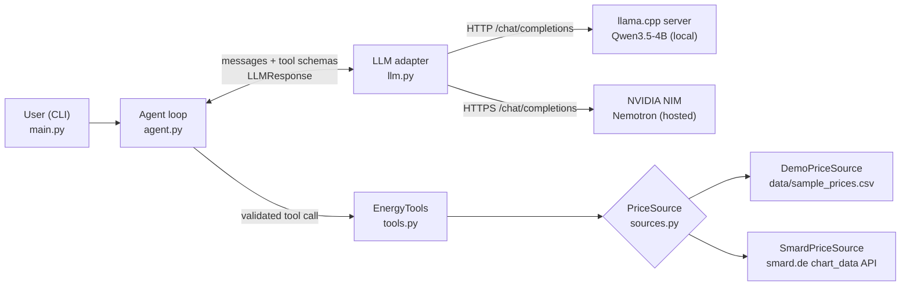
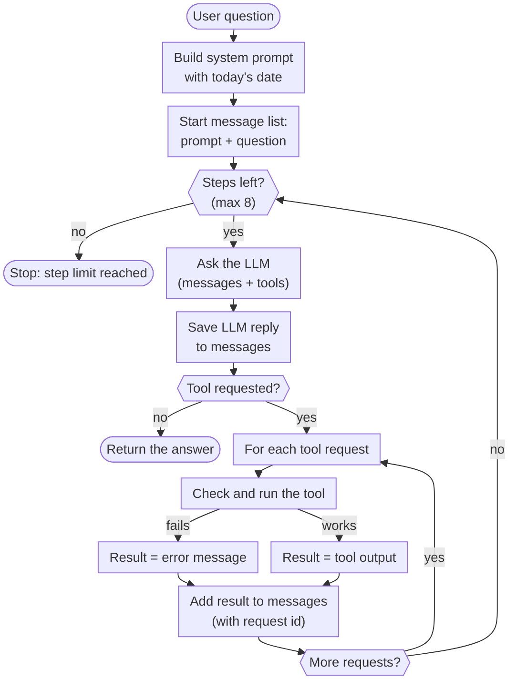
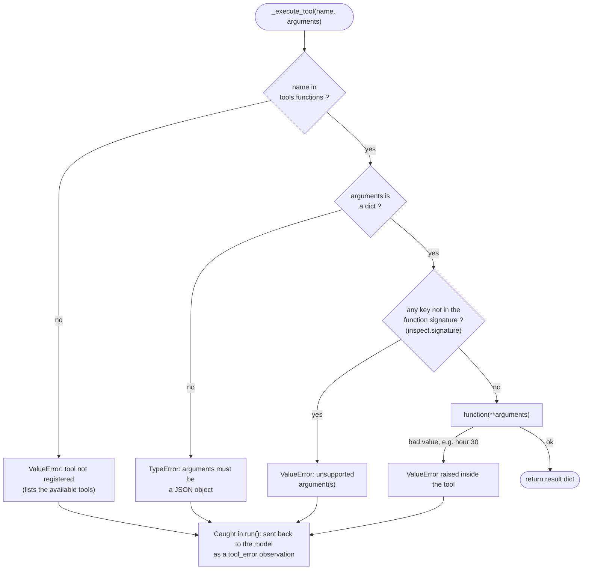
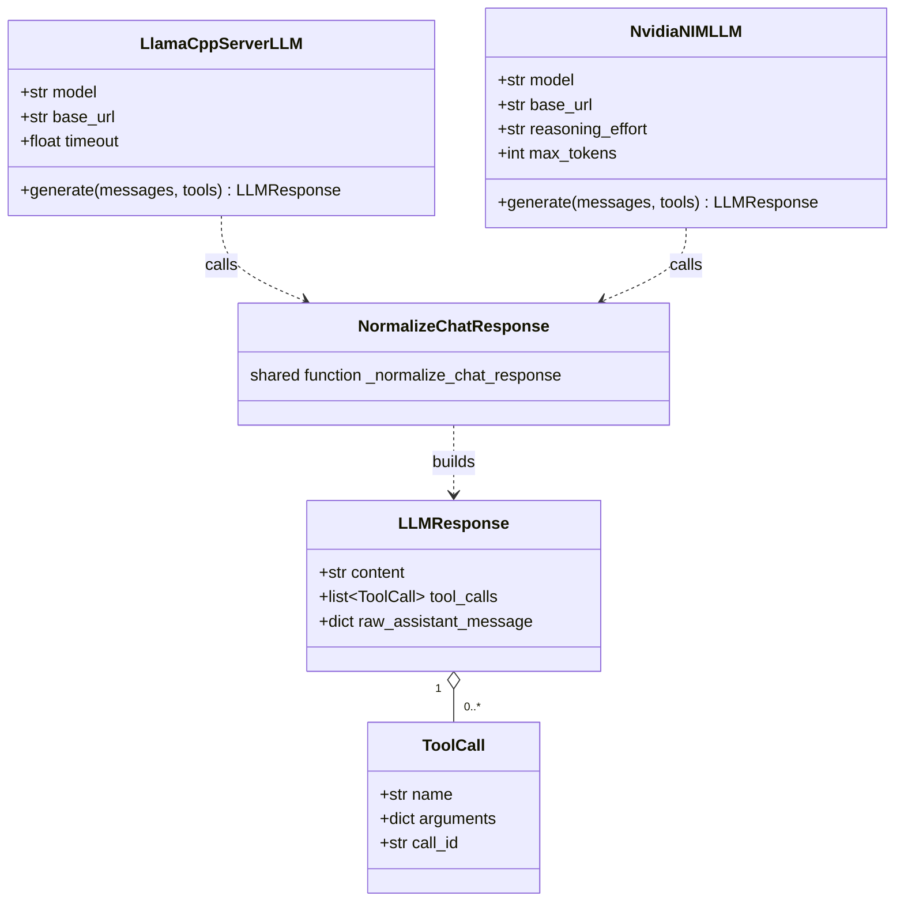
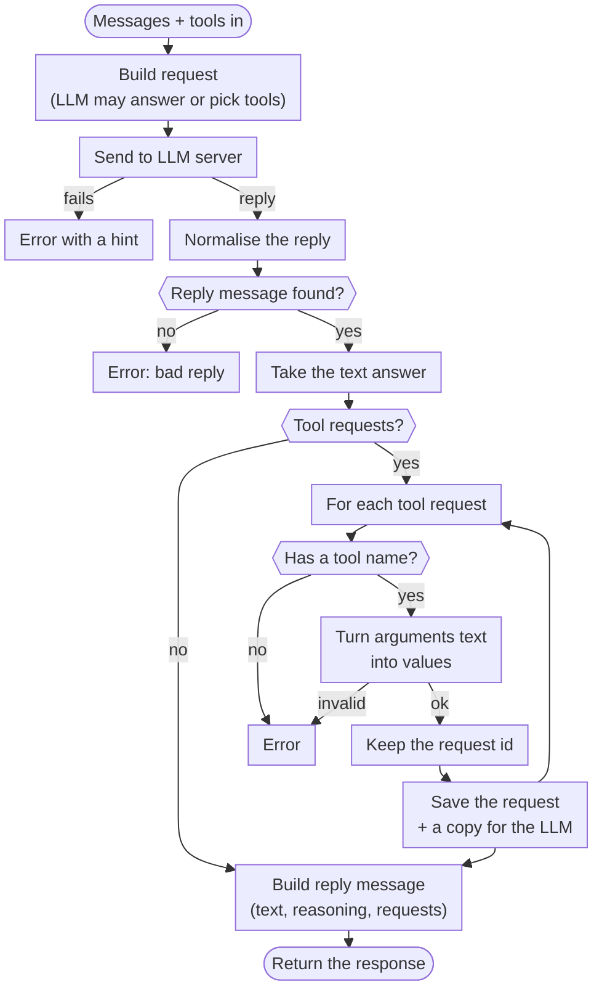
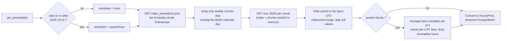

<div align="center">

# ⚡ Energy Price Planning Agent

**A hand-written, tool-using LLM agent that answers questions about German day-ahead electricity prices, finds the cheapest time to run an appliance, and estimates what that run costs on the wholesale market.**


[What it does](#what-it-does) ·
[Architecture](#architecture) ·
[Quickstart](#quickstart) ·
[agent.py](#agentpy--the-decision-loop) ·
[llm.py](#llmpy--the-provider-adapters) ·
[The 4 tools](#the-four-tools) ·
[The data](#the-data) ·
[Limitations](#known-limitations--roadmap)

</div>

---

## What it does

Ask a question in plain English. A language model decides **which of four tools to call**, reads the results, and either calls another tool or answers. No LangGraph, no agent framework: the whole loop is ~130 lines of Python you can read in one sitting.

| You ask | The agent does |
|---|---|
| *"What are the hourly prices tomorrow?"* | Calls `get_hourly_prices` and summarises the 24 values |
| *"When is the price lowest and how volatile is the day?"* | Calls `analyze_prices` (min, max, mean, median, std-dev) |
| *"Cheapest 3-hour slot tomorrow between 07:00 and 23:00?"* | Calls `find_cheapest_window` |
| *"What does a 2 kW run for 2 h from 11:00 cost?"* | Calls `estimate_run_cost` |
| *"What is the difference between EUR/MWh and EUR/kWh?"* | Answers directly, **no tool call** |

> [!IMPORTANT]
> Costs are the **wholesale day-ahead energy component only**. They exclude taxes, grid fees, supplier margin and every other part of a retail bill. The agent never switches a device on and never books anything.

**Design principle:** the model makes the *decisions* (which tool, which arguments, when to stop); Python keeps control of *validation, execution, data correctness and stopping*. The model is never allowed to invent a price: it can only report what a tool returned.

---

## Architecture



| Layer | File | Responsibility |
|---|---|---|
| CLI | [main.py](main.py) | Parses flags, picks provider + data source, runs the chat REPL |
| Agent | [energy_agent/agent.py](energy_agent/agent.py) | Observe → decide → act loop, argument validation, iteration cap |
| LLM | [energy_agent/llm.py](energy_agent/llm.py) | Talks to either provider and normalises replies into one format |
| Tools | [energy_agent/tools.py](energy_agent/tools.py) | JSON schemas shown to the model + the four deterministic functions |
| Data | [energy_agent/sources.py](energy_agent/sources.py) | Synthetic CSV source and live SMARD client behind one `PriceSource` protocol |

The agent depends only on the `LLMResponse` type and the `PriceSource` protocol, so a new model provider or data source drops in without touching the loop.

---

## Quickstart

### 1. Install

Requires **Python 3.10+** (the code uses `X | None` syntax; developed on 3.13). Windows PowerShell shown, adapt the activation line on macOS/Linux.

```powershell
cd energy-price-agent
py -3 -m venv .venv
.\.venv\Scripts\Activate.ps1
pip install -r requirements.txt
```

### 2. Pick an LLM provider

<table>
<tr>
<td width="50%" valign="top">

**Option A: local Qwen3.5-4B (default)**

Needs [llama.cpp](https://github.com/ggml-org/llama.cpp) **b9180 or newer** and the `Qwen3.5-4B-Q4_K_M.gguf` file (~2.7 GB) at `models/qwen3.5-4b/`. The `models/` folder is git-ignored, so you must download the model yourself.

```powershell
winget install llama.cpp
```

Start the server in a **separate terminal** and leave it running. `--jinja` is mandatory: it enables the chat template that makes tool calling work.

```powershell
llama-server.exe `
  --model "models\qwen3.5-4b\Qwen3.5-4B-Q4_K_M.gguf" `
  --ctx-size 8192 --jinja `
  --host 127.0.0.1 --port 8080
```

</td>
<td width="50%" valign="top">

**Option B: hosted NVIDIA NIM**

Create a `.env` file in the project root. It is git-ignored; never commit it.

```dotenv
NVIDIA_API_KEY=your_nvidia_api_key_here

# optional, defaults shown
NVIDIA_BASE_URL=https://integrate.api.nvidia.com/v1
NEMOTRON_MODEL=nvidia/nemotron-3.5-super-vl-120b-a12b
NEMOTRON_REASONING_EFFORT=low
NEMOTRON_MAX_TOKENS=8192
```

> [!WARNING]
> With this provider your prompts **and tool results** are sent to NVIDIA's servers. Usage limits and charges depend on your NVIDIA account.

</td>
</tr>
</table>

### 3. Run

```powershell
# local model + synthetic demo prices (offline, deterministic)
python main.py

# hosted model + live SMARD prices
python main.py --provider nvidia --data smard
```

| Flag | Values | Default | Purpose |
|---|---|---|---|
| `--provider` | `llama-cpp`, `nvidia` | `llama-cpp` | Which LLM adapter to use |
| `--data` | `demo`, `smard` | `demo` | Synthetic CSV or live SMARD API |
| `--model` | any model id | per provider | Override the model name |
| `--base-url` | URL | per provider | Override the OpenAI-compatible endpoint |
| `--max-steps` | integer | `8` | Max LLM calls per question |

Type `exit` or `quit` to leave. Every iteration, tool call and observation is printed so you can follow the model's reasoning.

### 4. Test

```powershell
python -m pytest -q      # 5 tests, no network or LLM needed
```

Environment variables already set in your OS take precedence over `.env` (`load_dotenv` does not override).

---

## `agent.py`: the decision loop

[energy_agent/agent.py](energy_agent/agent.py) contains the `Agent` class. `Agent.run(query)` is one complete question-to-answer cycle.

### Flow of `Agent.run()`



### Safety gate inside `_execute_tool()`

Model-generated arguments are untrusted input. Four checks run before a tool function is ever called:



A failure never crashes the loop. The error text goes back to the model as an observation so it can **self-correct** (for example, fix a malformed date) on the next iteration.

### How the `messages` list grows

The `messages` list *is* the agent's memory for one question. Each iteration appends to it, and the whole list is re-sent to the model every time.

Example: the full list for *"Find the cheapest 3-hour window tomorrow between 07:00 and 23:00"* after one tool round (demo data; long strings shortened with `...`):

```python
messages = [
    {   # 1. added at start: rules + current Berlin date
        "role": "system",
        "content": "You are an Energy Price Planning Agent for the German DE-LU day-ahead "
                   "electricity market. ... Current Berlin date: 2026-11-16\n"
                   "Current Berlin date and time: 2026-11-16T10:30+01:00",
    },
    {   # 2. added at start: the user's question
        "role": "user",
        "content": "Find the cheapest 3-hour window tomorrow between 07:00 and 23:00.",
    },
    {   # 3. iteration 1: the LLM asks for a tool (no text yet)
        "role": "assistant",
        "content": None,
        "tool_calls": [
            {
                "id": "call_2_0",
                "type": "function",
                "function": {
                    "name": "find_cheapest_window",
                    "arguments": '{"date": "2026-11-17", "duration_hours": 3, '
                                 '"earliest_hour": 7, "latest_hour": 23}',
                },
            }
        ],
    },
    {   # 4. the tool result, linked to the request by the same id
        "role": "tool",
        "content": '{"date": "2026-11-17", "status": "ok", "start_hour": 11, '
                   '"average_price_eur_mwh": 38.0, "hourly_prices_eur_mwh": [38.0, 34.0, 42.0], ...}',
        "tool_call_id": "call_2_0",
    },
    {   # 5. iteration 2: final answer, no tool_calls -> loop ends
        "role": "assistant",
        "content": "The cheapest 3-hour window tomorrow is 11:00-14:00, averaging "
                   "38 EUR/MWh (38, 34 and 42 EUR/MWh per hour).",
    },
]
```

| After… | Messages in the list |
|---|---|
| Start | `system` (rules + today's date), `user` (the question) |
| Iteration 1 | + `assistant` (contains `tool_calls`, e.g. `find_cheapest_window`) |
| Tool executed | + `tool` (JSON result, `tool_call_id` matching the assistant call) |
| Iteration 2 | + `assistant` (final text answer, no `tool_calls`) → **loop ends, text returned** |

### The system prompt (what the model is told)

| Rule | Why it exists |
|---|---|
| "Exactly four tools. Do not call every tool automatically." | Forces the model to *choose*, which is the point of the project |
| "Never invent, estimate, or fill missing market observations." | Prevents hallucinated prices |
| Relative dates ("tomorrow") must be converted using the injected Berlin date | Models don't know today's date; `{today}` and `{now}` are formatted in on every run |
| DE-LU only; prices are EUR/MWh | Keeps the scope explainable and the units unambiguous |
| Use `estimate_run_cost` for cost questions | Cost maths is done in code, not by the model |
| Report partial or missing data honestly | Matches the `status` fields the tools return |
| Ask **one** clarifying question if power or duration is missing | Avoids guessing a required input |
| Stay in domain; never claim an action was performed | Honest scope; no fake "I turned it on" |

### Key behaviours

- **Stateless between questions.** `run()` builds a fresh `messages` list each call, so there is no conversation memory across turns in the REPL.
- **Termination = no tool calls.** The loop has no special "final answer" tool; a reply without `tool_calls` *is* the answer.
- **Hard cap.** `max_steps` (default 8) bounds LLM calls, so a confused model cannot loop forever or run up API costs.
- **Tool calls run sequentially**, in the order the model returned them, even when the model emits several in one response.

---

## `llm.py`: the provider adapters

[energy_agent/llm.py](energy_agent/llm.py) hides the differences between a local llama.cpp server and NVIDIA's hosted API. Both speak the OpenAI-compatible `/chat/completions` protocol, and both are converted into the same two dataclasses.

### Class overview



### End-to-end flow of one `generate()` call



### Why normalisation matters

The OpenAI wire format carries tool arguments as a **JSON-encoded string**, but Python needs a **dict** to call `function(**arguments)`. The adapter therefore keeps two views of every tool call:

| View | Used for | Arguments form |
|---|---|---|
| `LLMResponse.tool_calls` (`ToolCall`) | The agent executes it | `dict` |
| `LLMResponse.raw_assistant_message` | Appended to `messages` and sent back to the model | JSON `str` |

The `call_id` ties them together: the tool observation the agent sends back must carry the same `tool_call_id`, otherwise the provider rejects the conversation or the model cannot match result to request.

`reasoning_content` (emitted by Nemotron) is preserved in `raw_assistant_message` so the provider receives the complete assistant turn on the next iteration.

### Provider comparison

| Setting | `LlamaCppServerLLM` (local) | `NvidiaNIMLLM` (hosted) |
|---|---|---|
| Default model | `Qwen3.5-4B` | `nvidia/nemotron-3.5-super-vl-120b-a12b` |
| Endpoint | `http://127.0.0.1:8080/v1` | `https://integrate.api.nvidia.com/v1` |
| Auth | none | `Authorization: Bearer $NVIDIA_API_KEY` header only (never in body or logs) |
| `tool_choice` | `auto` | `auto` |
| `parallel_tool_calls` | `True` | `False` |
| `temperature` | `0` (deterministic) | `1.0` with `top_p 0.95` |
| `max_tokens` | `1200` | `8192` (env `NEMOTRON_MAX_TOKENS`) |
| Reasoning | none | `reasoning_effort = low` (env `NEMOTRON_REASONING_EFFORT`) |
| Timeout | 300 s | 300 s |
| Fails fast if | server not running | `NVIDIA_API_KEY` missing (`ValueError` at construction) |

`tool_choice: "auto"` is what makes the agent agentic: the model itself decides between answering in text and requesting a tool.

---

## The four tools

Defined in [energy_agent/tools.py](energy_agent/tools.py). Each tool has (1) a JSON schema the model sees (`TOOL_SCHEMAS`) and (2) a deterministic Python function in `EnergyTools`. All prices are **EUR/MWh**, all tools accept `region` (only `DE-LU` is allowed), and every result includes a `source` field (`SMARD` or `synthetic_demo_data`) plus a `status`.

### 1. `get_hourly_prices(date, region="DE-LU")`

Returns the raw hourly price series for one day.

| | |
|---|---|
| **Use for** | "What are the prices at 18:00?", or when the model needs to inspect values |
| **Input** | `date` (`YYYY-MM-DD`) |
| **Returns** | `records[]` (`timestamp`, `hour`, `price_eur_mwh`), `available_hours`, `expected_hours` (24), `status`, `note` |
| **Status** | `complete` if exactly 24 hours, else `partial_or_unavailable` |
| **Honesty** | The note states missing hours are *not estimated*; demo data is flagged as synthetic |

### 2. `analyze_prices(date, region="DE-LU")`

Descriptive statistics for one day.

| | |
|---|---|
| **Use for** | Volatility, "when is it cheapest / most expensive?" |
| **Input** | `date` |
| **Returns** | `mean`, `median`, `minimum` + `minimum_at`, `maximum` + `maximum_at`, `range`, `population_std_dev`, `observations`, `status` |
| **Detail** | `minimum_at` / `maximum_at` are *lists*, so ties are all reported; rounded to 2 decimals |
| **Empty day** | Returns `status: no_data` instead of raising |

### 3. `find_cheapest_window(date, duration_hours, earliest_hour=0, latest_hour=24, region="DE-LU")`

Finds the cheapest block of consecutive hours, for scheduling.

| | |
|---|---|
| **Use for** | "When should I run the dishwasher (3 h) between 07:00 and 23:00?" |
| **Input** | `duration_hours` 1–12, `earliest_hour` 0–23 (inclusive), `latest_hour` 1–24 (exclusive) |
| **Method** | Slides a window across the day, rejects any window with a gap or outside the time limits, ranks by **average price**, returns the minimum |
| **Returns** | `start_at`, `end_at`, `start_hour`, `average_price_eur_mwh`, `hourly_prices_eur_mwh`, `hours_evaluated`, `full_day_coverage`, `coverage_note` |
| **Honesty** | With partial data the `coverage_note` warns that a cheaper window may sit in the missing hours |
| **No match** | Returns `status: no_complete_window` |

### 4. `estimate_run_cost(date, start_hour, duration_hours, power_kw, region="DE-LU")`

Wholesale cost of running a constant-power appliance.

```math
\text{cost (EUR)} = \sum_{h=1}^{\text{duration}} \frac{\text{power}_{kW} \times \text{price}_{h}\ (\text{EUR/MWh})}{1000}
```

| | |
|---|---|
| **Use for** | "What does a 2 kW run for 2 h from 11:00 cost?" |
| **Input** | `start_hour` 0–23, `duration_hours` 1–12, `power_kw` greater than 0 |
| **Returns** | `energy_kwh`, `hourly_prices_eur_mwh`, `estimated_wholesale_energy_cost_eur` (4 decimals), `explanation`, `important_limitation` |
| **Missing data** | `missing_start_hour` or `incomplete_window` instead of a guessed number |
| **Why it is a tool** | LLMs are unreliable at arithmetic; the model supplies *arguments*, Python does the maths |

<details>
<summary><b>Real tool output (demo data, run from the repo)</b></summary>

`find_cheapest_window("2026-11-17", 3, 7, 23)`:

```json
{
  "date": "2026-11-17",
  "region": "DE-LU",
  "source": "synthetic_demo_data",
  "status": "ok",
  "duration_hours": 3,
  "start_at": "2026-11-17T11:00:00+01:00",
  "end_at": "2026-11-17T14:00:00+01:00",
  "start_hour": 11,
  "average_price_eur_mwh": 38.0,
  "hourly_prices_eur_mwh": [38.0, 34.0, 42.0],
  "hours_evaluated": 14,
  "available_observations": 24,
  "full_day_coverage": true,
  "coverage_note": null
}
```

`estimate_run_cost("2026-11-17", 11, 2, 2)`, i.e. 2 kW × (38 + 34) ÷ 1000 = EUR 0.144:

```json
{
  "status": "ok",
  "start_at": "2026-11-17T11:00:00+01:00",
  "duration_hours": 2,
  "power_kw": 2,
  "energy_kwh": 4,
  "hourly_prices_eur_mwh": [38.0, 34.0],
  "estimated_wholesale_energy_cost_eur": 0.144
}
```

</details>

---

## The data

The agent reads prices through a single `PriceSource` protocol ([energy_agent/sources.py](energy_agent/sources.py)) that returns a list of `HourlyPrice(timestamp, price_eur_mwh)`. Timestamps are always timezone-aware **Europe/Berlin**. Two implementations exist.

### What a price is

The **day-ahead price** is the market-clearing price of electricity for each delivery hour of tomorrow, set in an auction held the day before. The **DE-LU** bidding zone covers Germany and Luxembourg. Prices are in **EUR/MWh** (divide by 1000 for EUR/kWh) and can be negative when supply exceeds demand.

### Source 1: demo data (`--data demo`)

[data/sample_prices.csv](data/sample_prices.csv): 24 rows, two columns (`hour` 0–23, `price_eur_mwh` integer). Fully **synthetic**, deterministic, works offline, and labelled `synthetic_demo_data` in every tool result.

| Property | Value |
|---|---|
| Rows | 24 (one per hour) |
| Minimum | 34 EUR/MWh at 12:00 |
| Maximum | 126 EUR/MWh at 19:00 |
| Mean / median | 82.38 / 84.5 EUR/MWh |
| Std-dev (population) | 23.4 EUR/MWh |
| Cheapest 3-hour block | 11:00–14:00, average 38 EUR/MWh |

The curve imitates a typical German "duck curve": a flat overnight plateau (about 78–91), a small morning shoulder (94 at 07:00), a **solar-driven midday trough** (34 at 12:00), then a steep **evening peak** (126 at 19:00) as solar fades.

<details>
<summary><b>All 24 values</b></summary>

| Hour | EUR/MWh | Hour | EUR/MWh | Hour | EUR/MWh | Hour | EUR/MWh |
|---|---|---|---|---|---|---|---|
| 00 | 91 | 06 | 88 | 12 | **34** (min) | 18 | 119 |
| 01 | 86 | 07 | 94 | 13 | 42 | 19 | **126** (max) |
| 02 | 82 | 08 | 89 | 14 | 55 | 20 | 113 |
| 03 | 79 | 09 | 76 | 15 | 69 | 21 | 104 |
| 04 | 78 | 10 | 59 | 16 | 83 | 22 | 98 |
| 05 | 80 | 11 | 38 | 17 | 101 | 23 | 93 |

</details>

> [!NOTE]
> The demo source **ignores the requested date**: it stamps the same 24 values onto whatever day you ask for. That makes demos reproducible, but the prices say nothing about the real market on that day.

### Source 2: live SMARD data (`--data smard`)

[SMARD](https://www.smard.de) is the German Federal Network Agency's public market-data portal. `SmardPriceSource` calls its `chart_data` endpoints (filter `4169` = day-ahead price, region `DE-LU`).



| Behaviour | Detail | Why |
|---|---|---|
| Resolution switch | Hourly before **2025-10-01**, quarter-hourly after | The EU day-ahead market moved to 15-minute products; the agent is hourly, so four quarter-hours are averaged |
| Aggregation key | UTC hour boundary, not local hour | Avoids ambiguous keys on the daylight-saving change day |
| Incomplete hours | Dropped, never filled | The agent must not fabricate market data |
| Weekly chunks | Only overlapping chunks are downloaded | SMARD publishes weekly blocks; this limits requests |
| Caching | Index and chunks cached per client instance | Repeated tool calls in one session do not re-download |
| Future dates | Often return few or no rows | Tomorrow's prices are published only after the auction; tools then report `partial_or_unavailable` |

---

## Design decisions

| Decision | Why |
|---|---|
| Hand-written loop instead of LangGraph / a framework | The agent is small enough to explain line by line; no hidden control flow |
| Model chooses tools (`tool_choice: auto`), Python validates and executes | Flexibility where it helps (intent), determinism where it matters (numbers, validation) |
| Reject unknown tool arguments via `inspect.signature` | Model-generated arguments are untrusted; silent acceptance hides bugs |
| Tool errors returned as observations, not raised | Lets the model correct itself instead of crashing the session |
| Provider-neutral `LLMResponse` + one shared normaliser | Swap a 4B local model for a 120B hosted one with zero changes to the loop |
| Cost arithmetic and statistics in tools, not in the model | Small models are unreliable at maths; tools are testable |
| Explicit `status` / `coverage_note` fields in every result | Gives the model structured grounds to admit missing data |
| Synthetic demo source clearly labelled | Reliable offline demos without passing synthetic numbers off as real |
| API key only in the `Authorization` header | Never leaks into prompts, logs or request bodies |
| `max_steps` cap | Bounds latency and API spend |

---

## Project structure

```text
energy-price-agent/
├── main.py                  # CLI entry point + chat REPL
├── requirements.txt         # requests, pytest, tzdata, python-dotenv
├── .env                     # local secrets (git-ignored)
├── data/
│   └── sample_prices.csv    # 24 synthetic hourly prices (demo mode)
├── energy_agent/
│   ├── agent.py             # system prompt + observe/decide/act loop
│   ├── llm.py               # llama.cpp and NVIDIA NIM adapters, response normaliser
│   ├── tools.py             # 4 tool schemas + EnergyTools implementations
│   └── sources.py           # PriceSource protocol, DemoPriceSource, SmardPriceSource
├── models/                  # local GGUF model (git-ignored, download yourself)
└── tests/
    └── test_tools.py        # 5 pytest tests (tools + quarter-hour aggregation)
```

## Tech stack

| Layer | Tools |
|---|---|
| Language | Python 3.10+ (developed on 3.13) |
| HTTP | `requests` (shared `Session` per client) |
| LLMs | Qwen3.5-4B (Q4_K_M GGUF) via llama.cpp · NVIDIA Nemotron via NIM |
| Config | `python-dotenv`, `argparse` |
| Time zones | `zoneinfo` + `tzdata` (needed on Windows) |
| Data | SMARD public API, local CSV |
| Tests | `pytest` |

---

## Known limitations & roadmap

- [ ] Only DE-LU and day-ahead prices are supported.
- [ ] No conversation memory: each question starts from a fresh `messages` list.
- [ ] Tool calls execute sequentially, so `parallel_tool_calls: true` (local provider) gains nothing.
- [ ] Days with a daylight-saving change have 23 or 25 hours; tools compare against a fixed 24 and report `partial_or_unavailable` / `partial_data`.
- [ ] `estimate_run_cost` cannot span midnight: a run crossing 24:00 returns `incomplete_window`.
- [ ] Relative-date handling depends on the model; verify the `date` argument in the printed trace.
- [ ] Wholesale price only: no taxes, grid fees or retail tariff.
- [ ] Tests cover the tools and aggregation only; there are no tests for the agent loop, LLM adapters, or live SMARD calls.
- [ ] No web UI, no persistence, no CI.
- [ ] No license file yet.

> [!NOTE]
> This is a planning assistant, not an energy-management controller. It never actuates devices.
