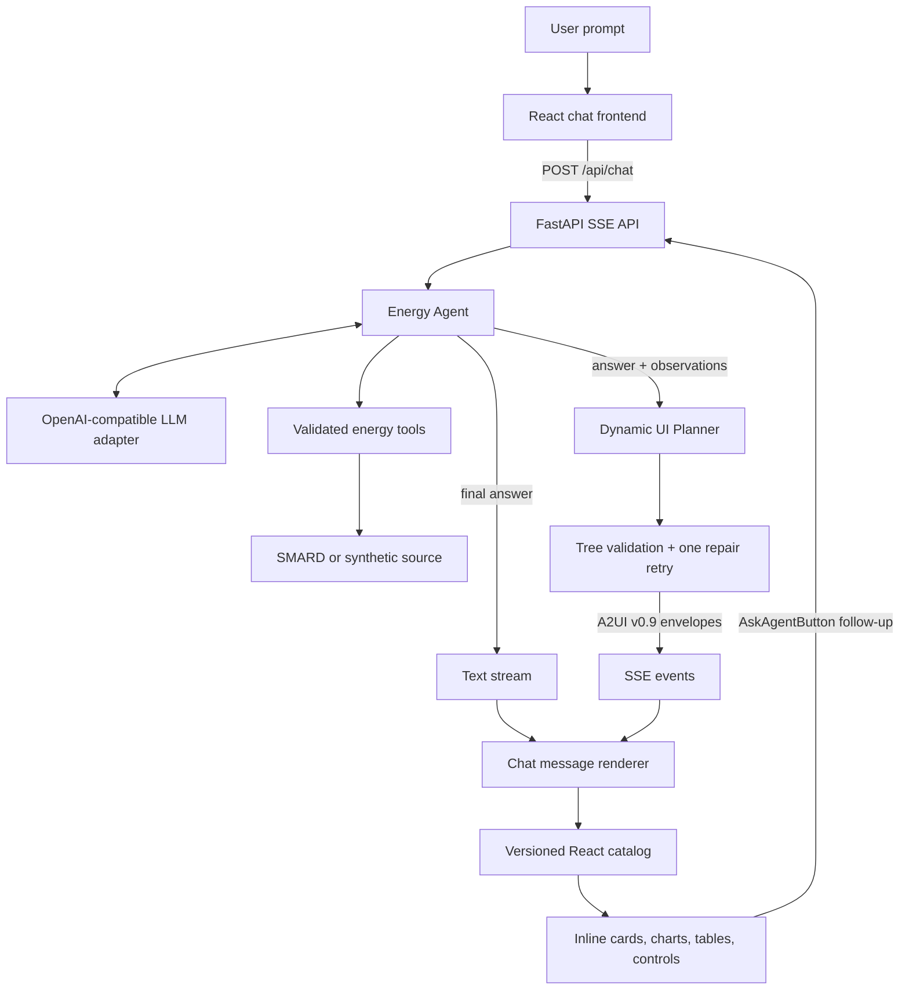

# Energy Price Planning Agent, Chat-native Dynamic GenUI


A tool-using agent for the German DE-LU day-ahead electricity market. This final codebase replaces the Streamlit-only interface with a React chat frontend. The assistant text streams into the chat; when a UI adds value, a separate UI-planner call generates an optional, validated, **inline** component surface. It does not generate or open webpages.


## What is implemented

- **Dynamic UI planning:** no fixed energy dashboard. The UI planner receives the user question, final answer, and tool observations, then either returns `render:false` or chooses a UI composition.
- **Chat-native UI:** A2UI-style `createSurface` and `updateComponents` messages are rendered inside the assistant transcript by a project-owned React catalog renderer.
- **Component catalog:** Text, Row, Column, Card, Metric, Chart (line/bar/area/scatter), DataTable (click-to-sort), List, local Slider, safe Calculator (whitelisted operations), AskAgentButton (follow-up only), and Callout.
- **Streaming and reconnect:** final answer text, agent trace and UI events are sent over SSE with monotonically increasing event IDs. The API retains a bounded in-memory event log for one hour so the browser can replay missed events after a transient connection interruption. A2UI surface messages remain separate rendering events.
- **Local interactions:** sliders and calculators update immediately in the browser. Ask-agent buttons send an ordinary follow-up prompt to the backend. The text transcript supports GitHub-Flavoured Markdown, including rendered tables.
- **Bounded validation:** supported types/operations only; unique IDs; limits on nesting, component count, chart data and table rows; no generated JS/HTML execution. One repair attempt is made for invalid UI output; if it still fails, the text answer remains.
- **Tool deduplication:** repeated identical tool calls are cached within a single agent turn.
- **Stop/cancel:** the Stop button calls an explicit API cancellation endpoint. A transient SSE disconnect does not cancel the agent; the browser reconnects and replays missed events. Cancellation is checked between provider/tool steps; an already-running provider HTTP request cannot be forcibly terminated and may continue until its request timeout.
- **Conversation context:** previous messages remain in browser memory for the current page session and the last 10 question/answer exchanges (20 messages) are **always** sent with each request; there is no switch to turn this off (a character budget drops the oldest messages first if the window is very long). Resolved slots from the previous turn (`date`, `duration_hours`, `power_kw`, …) are returned in the `done` event and resent as `state`, so follow-ups such as “make it four hours instead” keep their referents. This is not durable or server-side memory; use **New chat** to clear both messages and carried state.
- **Agent trace:** the collapsed “Behind the scenes · Agent execution” section displays iteration decisions, tool names, tool arguments and structured tool observations emitted by `agent.py`. It deliberately excludes provider `reasoning_content` and A2UI protocol payloads.
- **Providers:** hosted NVIDIA NIM (default) or a local llama.cpp server through the OpenAI-compatible endpoint. The provider is **backend configuration only** (`LLM_PROVIDER`); the dashboard shows no provider selector.
- **Data:** live SMARD is default; synthetic demo CSV can be selected.


## Architecture



Delivery is always **progressive**: the text answer is shown as soon as it is ready and the optional UI is appended when planning completes. A "wait for text + UI" mode was evaluated and removed: the UI needs a second, optional model call, so holding a finished answer back for it only adds latency and makes a UI failure delay (or hide) the answer. A turn has two stages: (1) the tool/decision loop, which is never streamed so planning text cannot leak into the transcript, and (2) an optional UI-planner call. The model's first response without a tool call is the answer itself; it is generated once and emitted to the chat, so there is no second full answer call and no risk of two generations disagreeing. The agent carries resolved slots from the previous turn into the system prompt so follow-ups resolve against the right date and assumptions. UI generation adds a bounded repair call only when the first UI plan fails parsing or validation. The UI planner uses the evidence in the turn; the prompt asks it not to invent data, but semantic factual grounding of all UI prose is not mechanically proven.


## A2UI implementation note

The project emits the `v0.9` wire envelopes (`createSurface`, `updateComponents`) with a versioned custom catalog ID. The official maintained A2UI React renderer is **not installed** here. Instead, the project includes a custom React renderer for the component catalog, including its chart/table/calculator extensions. This means:

- It is a project-owned chat-native renderer for this A2UI-style subset and custom catalog.
- It does not execute generated HTML/JavaScript.
- It does not claim full official A2UI schema conformance or compatibility with an unmodified renderer.
- `catalog.json` is the catalog contract. Add components there, then implement their renderer and validation together.

The official A2UI renderer documentation currently describes the shared web core and renderer implementation model; check the compatibility matrix before switching protocol/renderer versions. Official React renderer support and A2UI v1.0 availability have not been browser-verified in this codebase.


## Project layout

```text
.
├── api.py                  # FastAPI endpoint, SSE, bounded concurrency, cancellation flag
├── main.py                 # CLI entry point / LLM provider setup
├── catalog.json            # Versioned chat component catalog manifest
├── examples/                # Example JSON UI plan (synthetic only)
├── energy_agent/
│   ├── agent.py             # Tool loop, dedupe, event emission
│   ├── genui.py             # Dynamic UI planner, validation, A2UI message assembly
│   ├── llm.py               # Streaming OpenAI-compatible adapters
│   ├── tools.py              # Energy tool schemas and deterministic functions
│   └── sources.py             # Demo and SMARD data sources
├── frontend/
│   ├── src/                  # Chat UI + custom A2UI catalog renderer
│   ├── package.json           # Includes remark-gfm for Markdown tables
│   └── vite.config.ts
├── tests/
└── data/sample_prices.csv
```


## Quickstart (Windows PowerShell)

### 1. Python backend

```powershell
py -3.11 -m venv .venv
.\.venv\Scripts\Activate.ps1
python -m pip install --upgrade pip
python -m pip install -r requirements-dev.txt
# requirements.txt = runtime only (also used by the Render deployment, includes tzdata for Windows);
# requirements-dev.txt adds the test dependencies (pytest, httpx2).
Copy-Item .env.example .env
```

Edit `.env` and add `NVIDIA_API_KEY` (NVIDIA NIM is the default provider). To use a local llama.cpp server instead, start it and set `LLM_PROVIDER=llama-cpp` in `.env`; the dashboard has no provider selector.

Start the backend:

```powershell
python -m uvicorn api:app --host 127.0.0.1 --port 8000
```

### 2. React chat frontend (second terminal)

```powershell
cd frontend
npm install
npm run dev
```

Open `http://127.0.0.1:5173`.

### 3. Demo data

In `.env`, set:

```dotenv
PRICE_SOURCE=demo
```

Restart the backend. Synthetic demo values are labelled in tool results; don't treat them as live market prices.

### 4. CLI remains available

```powershell
python main.py --provider nvidia --data smard
# or
python main.py --provider llama-cpp --data demo
```

### 5. Python tests

```powershell
python -m pytest -q
```


## Configuration

| Variable | Default | Description |
|---|---|---|
| `LLM_PROVIDER` | `nvidia` | Backend-only provider choice: `nvidia` or `llama-cpp` |
| `NVIDIA_API_KEY` | — | Required for hosted NIM |
| `NVIDIA_BASE_URL` | NVIDIA endpoint | OpenAI-compatible API URL |
| `NEMOTRON_MODEL` | project default | Hosted model ID |
| `NEMOTRON_REASONING_EFFORT` | `low` | Reasoning setting forwarded to provider |
| `NEMOTRON_MAX_TOKENS` | `8192` | Hosted output budget |
| `PRICE_SOURCE` | `smard` | `smard` or `demo` |
| `UI_PLANNER_JSON_MODE` | `1` | Send `response_format=json_object` to the UI planner; set `0` if your endpoint rejects it |
| `AGENT_MAX_STEPS` | `0` | Optional iteration-count ceiling; `0` means no count limit |
| `AGENT_MAX_RUNTIME_SECONDS` | `900` | Runtime safety limit; `0` disables it |
| `MAX_CONCURRENT_AGENT_RUNS` | `2` | Backend concurrency slots |
| `CHAT_CORS_ORIGINS` | local Vite origins | Comma-separated browser origins |
| `VITE_API_BASE_URL` | `http://127.0.0.1:8000` | Frontend API endpoint; set in `frontend/.env.local` if needed |


### Data and DST

German market days are not always 24 hours: the Berlin spring-forward day has 23 and the autumn fall-back day has 25. Tool completeness checks derive the expected hour count from the real local day, and window/cost calculations step through absolute hours, so repeated or skipped local hours are handled rather than reported as missing data. The demo source follows the same rule.


## Conversation context and debugging

Conversation messages are held in React component state only while the page remains open. The frontend always sends the last 10 question/answer exchanges (20 messages) as `history` plus the previous turn's resolved `state`. Use **New chat** to clear the visible transcript and the carried state. The **Behind the scenes** panel shows the agent execution trace emitted by `agent.py` (iteration decisions, tool arguments and tool observations); it does not expose A2UI protocol JSON or provider-internal reasoning. The agent has no iteration-count limit by default: it continues until the model stops requesting tools, subject to the 15-minute runtime safety limit. Set a positive `AGENT_MAX_STEPS` to enable an optional count ceiling. SSE events are buffered server-side briefly and can be replayed after a transient browser-stream interruption. A `request_id` reused with a different payload is rejected with HTTP 409 rather than attaching to the earlier answer.

## Current safety / operational limits

- This is a **local-development codebase**, not a public production deployment. It has no authentication, user accounts, durable conversation storage, distributed rate limiting, or reverse-proxy hardening. Keep the API bound to localhost until these are added.
- The model can propose UI components and values. Server validation enforces the catalog and bounds, but the UI planner's factual claims still require evaluation/grounding tests. Chart/table data are requested to be based on evidence.
- The generated UI cannot execute model-supplied code. Calculators use fixed operations, and interactive buttons can only submit a follow-up prompt.
- Python regression tests pass in the authoring environment. A frontend `npm install` / Vite build and browser end-to-end test could not be completed here because package installation timed out; frontend compilation is therefore **not verified** here. Dependencies are version-pinned in `package.json`; `npm install` on your machine will install `remark-gfm` and generate a lockfile.
- A2UI messages and custom catalog are validated by the project's own code/tests, not by the official A2UI schema validator. Before deploying beyond localhost, pin and integrate the official schemas/renderer or expand the integration tests.


## Deployment: backend on Render (free), frontend on Vercel

The backend is a long-lived FastAPI process (SSE streaming, in-memory jobs), so it needs a host that runs one, not Streamlit or serverless functions. `render.yaml` defines the free Render web service.

**1. Push the project folder to GitHub** (the repository root must be this folder; `.env` is git-ignored, never commit it).

**2. Backend on Render**
1. Render dashboard → **New → Blueprint** → select the repository. Render reads `render.yaml`.
2. When asked, enter `NVIDIA_API_KEY` and `CHAT_CORS_ORIGINS`. For now put a placeholder origin; you set the real one in step 4.
3. Wait for the deploy and open `https://<your-service>.onrender.com/api/health`; it should return `{"status":"ok",...}`.

**3. Frontend on Vercel**
1. **Add New → Project** → import the same repository.
2. Set **Root Directory** to `frontend`. Vercel detects Vite (build `npm run build`, output `dist`).
3. Add the environment variable `VITE_API_BASE_URL` = your Render URL, `https://<your-service>.onrender.com` (no trailing slash). It is applied at build time, so redeploy after changing it.

**4. Connect them**: in Render, set `CHAT_CORS_ORIGINS` to your Vercel URL, e.g. `https://your-app.vercel.app` (no trailing slash, `https`; several origins can be comma-separated). Render redeploys automatically. Each Vercel *preview* URL is a different origin and must be added too if you want to use it.

**Free-tier behaviour to expect**
- The service sleeps after about 15 minutes without traffic and needs up to a minute to wake. The frontend pings `/api/health` when the page opens and retries a failed first message for roughly 70 seconds, showing "Connecting to the server… it may be waking up".
- Render may restart a free service at any time. Running jobs and the replay log live in memory, so a restart during an answer loses that answer; the user just asks again. Conversation history lives in the browser, so it survives.
- Free-tier terms change; check Render's pricing page before relying on them.
- **There is no authentication.** Anyone who finds the backend URL can spend your NVIDIA quota. `MAX_CONCURRENT_AGENT_RUNS` caps parallel runs but is not a rate limit. Add auth or per-IP rate limiting before sharing the URL widely.

## Extending the UI catalog

1. Add a component definition to `catalog.json`.
2. Add its shape, bounds, and safety validation in `energy_agent/genui.py`.
3. Add conversion to the A2UI-style `updateComponents` list in `ui_tree_to_a2ui`.
4. Implement the matching React component in `frontend/src/renderer.tsx`.
5. Add validation and rendering tests. Do not add generated executable JS or arbitrary HTML.


## Reference links

- A2UI protocol: https://github.com/a2ui-project/a2ui/blob/main/specification/v1_0/docs/a2ui_protocol.md
- A2UI renderer guide: https://github.com/a2ui-project/a2ui/blob/main/docs/public/guides/renderer-development.md
- A2UI client setup: https://github.com/a2ui-project/a2ui/blob/main/docs/public/guides/client-setup.md
- React: https://react.dev/
- Vite: https://vite.dev/
